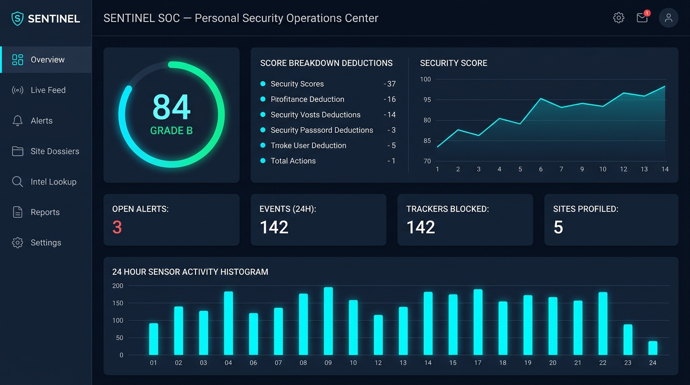
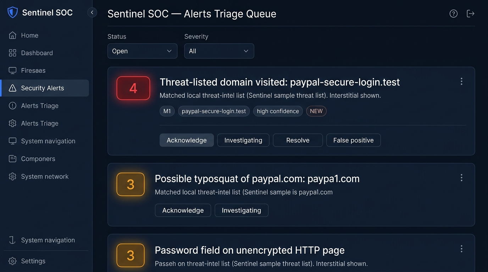
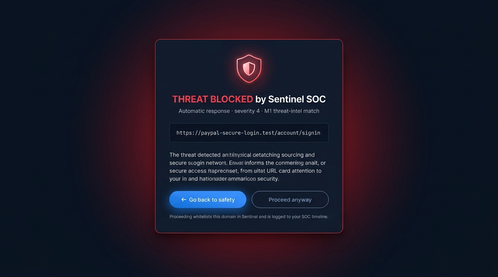
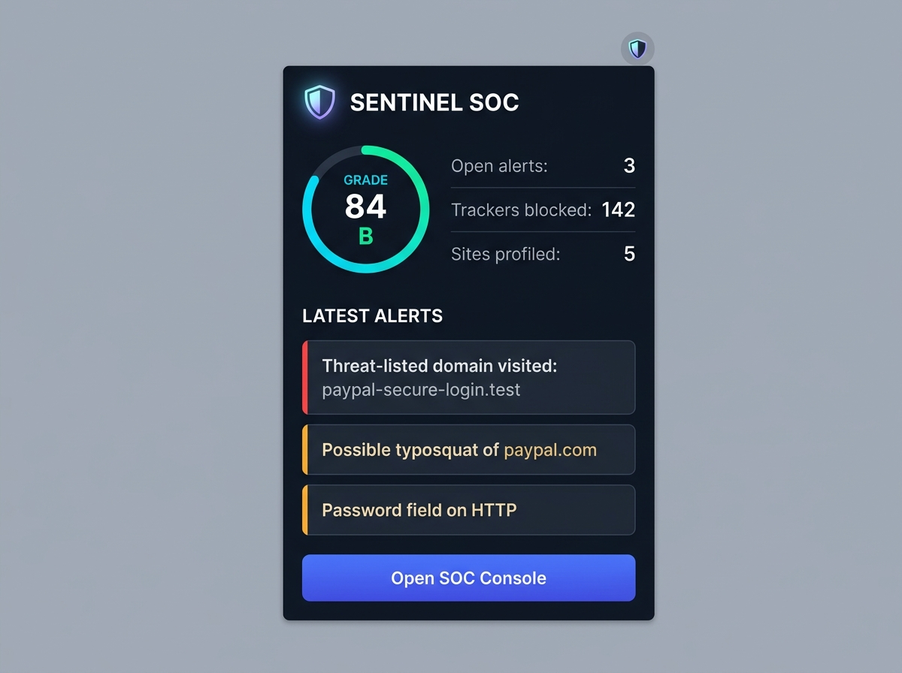

# Sentinel — Personal Browser SOC · v0.1.1

> **Developed by Dev-Hunters Studio**  
> A single-user Security Operations Center that lives inside your browser. It monitors your browsing, detects threats targeted at you, raises alerts you triage like an analyst, and scores your real-time security posture.

---

## 📸 Interface Preview

### 1. SOC Console Overview
The analyst overview features a live **Security Posture Score** ring (Grade A–F), active score deduction audit, a 14-snapshot historical trendline, and a 24-hour sensor activity histogram.



---

### 2. Alerts Triage Queue
Triage incidents in real time using analyst response workflows (**Acknowledge**, **Investigating**, **Resolve**, or mark as **False Positive**).



---

### 3. Automatic Response Interstitial
When severity-4 threat-listed domains are encountered, Sentinel intercepts the navigation and serves a high-priority warning card. Analysts can safely retreat or override and whitelist.



---

### 4. Extension Toolbar Popup
Quickly check open alert counts, total blocked trackers, profiled sites, and the live security gauge directly from the browser action popup.



---

## 🛡️ What's Inside

| Module | Purpose & Capabilities |
|---|---|
| **M1 · URL & Domain Monitor** | Multi-part ccTLD parsing (`.co.uk`, `.com.au`, `.co.jp`), redirect chain logging, punycode IDN homograph detection, SLD typosquatting & TLD-swap checks, and threat-intel matching. |
| **M2 · Phishing Detector** | Login & password form scanner with word-boundary brand impersonation checks (e.g., claiming "PayPal" on an unapproved domain). |
| **M3 · Connection Hygiene** | Alerts on cleartext credentials over unencrypted HTTP, monitors mixed content, and tracks HSTS per domain. |
| **M5 · Tracker Shield** | Declarative Net Request (DNR) blocking rules for 44 tracker and analytics networks; canvas fingerprint sensor operating in the MAIN world. |
| **SOC Console** | 7-tab console: **Overview**, **Live Feed**, **Alerts**, **Site Dossiers**, **Intel Lookup**, **Reports** (JSON/CSV export), and **Settings**. |
| **Auto-Response** | Severity-4 threat matches trigger an automated warning interstitial; analyst can go back or whitelist-and-proceed. |

*Everything runs **100% locally** on your device — no external API keys, no accounts, and zero telemetry.*

---

## 📦 Distribution Pack & Install

### Option A: Install from Unpacked Folder (Developer Mode)
1. Open Chrome and go to `chrome://extensions`
2. Enable **Developer mode** (toggle in the top-right corner)
3. Click **Load unpacked**
4. Select the `sentinel-soc/` folder
5. Pin the 🛡️ Sentinel icon to your toolbar and click **Open SOC Console**

### Option B: Packaged Release ZIP
Pre-packaged ZIP bundles ready for archiving or store submission are located in:
* `dist/sentinel-soc-v0.1.1.zip` (complete extension bundle with assets, rules, and documentation).

---

## 🎯 Demo & Verification Scenarios

Sentinel bundles sample threat indicators using RFC-2606 reserved domains (`.test` / `.example`), ensuring safe evaluation without visiting live malicious sites:

- **Typosquat Alert**: Visit `http://paypa1.com` or `http://paypal.xyz` (Severity 3, M1)
- **Punycode / Homograph Alert**: Visit `http://xn--pypal-4ve.com` (Severity 3, M1)
- **Cleartext Password Warning**: Visit any plain HTTP site with a login form (Severity 3, M3)
- **Threat-List Interstitial**: Visit `https://paypal-secure-login.test` (Severity 4 auto-response warning page)
- **Intel Lookup**: Open SOC Console → **Intel Lookup** → paste any URL to run local indicator verdicts

Triage the generated alerts in the console (Acknowledge → Investigating → Resolve) to watch your posture score improve dynamically, then export a sanitized CSV or full JSON dossier from the **Reports** tab.

---

## 📂 Project Layout

```
sentinel-soc/
├── manifest.json            # Manifest V3 configuration (MAIN world injection, tightened resources)
├── background.js            # Service worker: detection engine, event bus, alert manager, scoring
├── content.js               # Isolated-world content script: DOM form scanning & event bridge
├── inject.js                # MAIN-world sensor: canvas fingerprint readback detection
├── popup.html / popup.js    # Toolbar action popup: posture ring, quick stats, recent alerts
├── dashboard.html / js / css# SOC Console dashboard (7 tabs, dark cyber theme)
├── warning.html / warning.js# Auto-response severity-4 interstitial
├── data/                    # Local threat feeds: threatlist.json, brands.json, popular.json, trackers.json
├── rules/trackers.json      # DeclarativeNetRequest block ruleset
├── icons/                   # Extension icons (16px, 48px, 128px)
├── screenshots/             # High-resolution screenshots of the console and views
└── dist/                    # Packaged zip distribution ready for installation/submission
```

---

## 🚀 Recent Improvements in v0.1.1

- **CSP-Compliant Injection**: Migrated page-world canvas sensor into native Manifest V3 `world: "MAIN"` content scripts, eliminating CSP violations on strict domains like GitHub and banks.
- **Multi-Part TLD Support**: Enhanced domain parsing to correctly handle `.co.uk`, `.com.au`, `.co.jp`, `.co.in`, etc.
- **SLD Typosquatting & TLD-Swap Protection**: Catches brand spoofing across alternative TLDs (`paypal.xyz`) while eliminating false positives on short domains like `x.com`.
- **Phishing Heuristic Tuning**: Implemented word-boundary matching (`\bbrand\b`) with login/authentication context keywords to eliminate false positives on benign pages.
- **Sanitized CSV Reports**: Ensured all exported report fields and URLs are safely double-quoted to prevent formatting errors with complex query parameters.
- **Standalone Preview Support**: Added realistic mock fallback so dashboard, warning, and popup views can be previewed or screenshot in any standard browser environment.

---

## 👨‍💻 Credits & Author

Developed by **dev-hunters studio**.

